# Pico2W DualSense 5 Bridge — OLED Edition

**English** · [中文](README.CN.md) · [Deutsch](README.DE.md) · [Español](README.ES.md) · [Français](README.FR.md) · [日本語](README.JA.md) · [Português (Brasil)](README.PT-BR.md)

> Turn a Raspberry Pi Pico2W into a wireless adapter for the DualSense (DS5) controller — with an optional on-board status display.

> **OLED Edition** is a fork of **[awalol/DS5Dongle](https://github.com/awalol/DS5Dongle)** (upstream) that adds an optional Pico-OLED-1.3 128×64 display add-on with 11 screens (status, 4-slot multi-controller pairing, light bar color picker with favorites and effect presets, trigger test, gyro tilt, touch pad, diagnostics, CPU/clock, BT signal strength, audio VU meters, and a persistent settings menu), plus a DS5 button-combo soft-reboot. Upstream is the authoritative source for the core bridge firmware; this fork tracks it and layers add-on features on top.

> **🧪 Want the newest features? Try the Development channel.** In the app: **App settings → Updates → Development** (it asks first; **Back to stable** returns you any time). Development builds pass the same automated tests on every change; stable releases also get the full release checks on real hardware and Windows, plus time in everyday use. The current one, **0.9.5-dev.19** (Release Candidate 1), adds over stable 0.9.4:
>
> - **DualSense Edge:** remap the Fn and back buttons, Edge profiles in PlayStation Accessories, and its own drawing and OLED view
> - **Sticks:** response curves and stick tests
> - **Controller mic:** level control, echo cancellation, and the mute light follows mute; the PC's mute and mic volume reach the controller
> - **Sleep and wake:** the controller turns off when the PC sleeps, and the PS button can wake the PC
> - **Games (Linux):** pick any Proton version per game, HDR setup, and XInput-only games find the controller
> - **Work the OLED from the app:** KEY0/KEY1 and the controller buttons beside the live screen, plus **Share the OLED** (PNG, clipboard or GIF)
> - **Controller firmware check** and controller health info
> - **Headset (Linux):** stereo when a headset goes into the controller, and back to the speaker when it comes out
> - **Pairing on the board:** the OLED says *Press PS to connect*; hold KEY0 for 2 s to pair, with a countdown; no endless scanning while idle
> - **Every message in 7 languages**

---

## 🛠️ Get started: download the app

**[→ Download the DS5 Dongle OLED Edition Configurator](https://github.com/MarcelineVPQ/DS5Dongle-OLED-Edition/releases/latest)** (Linux AppImage, a Windows installer that needs no admin rights, and the universal macOS app; tested on Linux, Windows 11 and macOS, where the macOS smoke test installs and runs it on a real Apple Silicon Mac. It has also been [reported working on macOS 27.0.1](https://github.com/MarcelineVPQ/DS5Dongle-OLED-Edition/issues/17).)

The app is all you need. Each release includes the matching firmware, so the app installs it on your Raspberry Pi Pico 2 W, keeps it up to date, and configures everything:

1. Build the dongle (see [Hardware](#hardware) below) and start the app.
2. Plug the Pico in **while holding its BOOTSEL button** (a brand-new Pico doesn't need the button). The app finds it and installs the firmware with one click; nothing to copy by hand.
3. Pair your controller: hold **PS + Create** until the light bar flashes. The app shows when it's connected.


Your controller is drawn in its own colors and moves as you use it; click any part to set it up. The **[step-by-step guide](https://github.com/MarcelineVPQ/DS5Dongle-OLED-Config-Web/blob/master/docs/GUIDE.md)** walks through everything, from building the dongle to each setting:

- **The controller:** light bar modes and favorites, adaptive trigger effects, **haptic feedback with vibration intensity per side** (haptic feedback and classic vibration, with a 3-second test), Audio Auto Haptics, speaker and built-in microphone (with tests), button assignments (every button in one list, the DualSense Edge's Fn buttons and back buttons too, and **saved button layouts** a game can switch in while it runs, never written to flash: firmware v0.9.4), the four pairing slots, and **Controller info** (the controller's own firmware, checked against Sony's latest, its battery voltage and lifetime counters).
- **Calibration:** stick drift, sticks or triggers that don't reach full, a creeping gyroscope, fixed in the dongle (per pairing slot) for every game; nothing is written to the controller. Plus a **sensitivity curve** per stick and stick tests (circularity and drift).
- **The dongle:** its OLED screen mirrored live, a diagnostics dashboard (temperature, clock, Bluetooth and USB traffic, the audio pipeline, and how long each part of the firmware takes), power, display and USB settings, and **one-click firmware updates** (no BOOTSEL button, no drive copying).
- **Games:** your Steam, Heroic and Lutris library (Windows: Steam, GOG Galaxy and Epic) as a list and a cover grid, with per-game controller profiles (every controller setting the game changes, including a button layout and stick curves, edited live in the controller view), DualSense support per game, and on Linux setup fixes plus the DualSense Proton build.
- **Made yours:** a theme in your controller's colors, Glass, look sliders, color vision modes, Reduce motion, a narrator through the controller's speaker, 7 languages, a tray icon.

The app talks to firmware **v0.8 or newer** through a small configurator USB interface (calibration and the per-grip haptics need **v0.9**; the app offers the update). Games never see it, so the dongle still looks exactly like a real DualSense. App source: **[MarcelineVPQ/DS5Dongle-OLED-Config-Web](https://github.com/MarcelineVPQ/DS5Dongle-OLED-Config-Web)**.

> **The browser config tool has been retired**: the desktop app does everything it did and more. Its old address, [marcelinevpq.github.io/DS5Dongle-OLED-Config-Web](https://marcelinevpq.github.io/DS5Dongle-OLED-Config-Web/), is now the app's download page. To flash a Pico without the app, hold BOOTSEL while plugging it in and copy the `.uf2` from the release onto the drive that appears.

## 🔄 Updates and firmware installs, done for you

**The app keeps itself up to date.**

- **Signed and checked.** Every update comes from one feed signed with our Ed25519 key. The app ignores a feed without a valid signature, checks each download's size and SHA-256 before installing it, and never installs an older version by itself.
- **Two channels:** **Stable** for everyone, **Development** for the newest features. **Back to stable** returns both the app and the firmware to the latest stable release.
- **Your choice:** with **Install updates automatically** on (the app asks once), updates download and get checked in the background, and the new version starts the next time you open the app. With **Check for updates automatically** off, the app goes online only when you press a check button.
- **Per system:** on Linux the AppImage puts the new version beside itself and the menu entry follows it. On Windows the per-user installer runs without admin rights. On macOS the app shows the update with a link to the release.

**Firmware installs in one click.**

- **Bundled:** every app release carries the firmware it was built and tested with, so a new board can be set up offline. Newer firmware comes from the same signed feed.
- **First-time setup:** plug the Pico in while holding BOOTSEL (a brand-new Pico needs no button). The app finds it and installs the firmware.
- **Updates:** no button and no drive copying. The app restarts the board into BOOTSEL itself, writes the firmware over USB and reconnects.
- **Checked before writing:** the file's SHA-256 must match the feed, and it must be firmware for this chip. A file that fails writes nothing.
- **Checked after writing:** the app waits for the new firmware to start. If the board comes back in BOOTSEL instead, the app says so and offers **Install again**. While firmware is being written, the app won't restart, quit or update itself.
- **Your setup stays:** settings, pairings, calibration and button assignments live in their own part of the flash. Every firmware build is checked to stay clear of it, and an app test checks that an update writes only the sectors of the firmware file.

## 🔬 How it's built and tested

Every change runs the full set of automated checks. Every release adds more on top. The complete list, with the files behind each check: [docs/QUALITY.md](docs/QUALITY.md) (English).

**Every change**

- **App:** over 1,800 tests (unit, integration and security) on Linux, Windows and macOS, plus typecheck, ESLint and Prettier.
- **Firmware:** over 270 host tests of the firmware's logic with AddressSanitizer and UndefinedBehaviorSanitizer, and five firmware builds (Pico 2 W, Pico W, debug and two variants). The build fails if the time-critical code leaves RAM or the flash setup changes.
- **App rule gates:** the Electron security settings, no unsafe HTML, one theme system with no stray colors, no duplicate code or files without a verdict.
- **Written verdicts:** every loop that waits or runs on a hot path, every error path, every cache and every resource the code takes (a timer, a listener, a device) carries a comment with its verdict. A new one without a verdict fails the check.
- **Security scans:** Semgrep, Gitleaks and npm audit, also weekly.

**Every development build**

- **UI checker:** its own copy of the app with a simulated board opens every page in all 7 languages at two window sizes. It fails on clipped text, contrast below WCAG AA, or a control without a name.
- **Resource budgets** measured on Linux and in a Windows 11 VM.
- **Windows** test of the installed app in a Windows 11 VM, and a **macOS** smoke test on a real Mac in GitHub Actions (installed the way a user does, started and driven).

**Before a stable release**

- **The full UI check:** every screen and panel, all 7 languages, both sizes, every theme and style, every colorway of both controller models.
- **The long budget run,** with a 30-minute soak for memory growth, on Linux and Windows.
- **Hardware checks** on a real board with a DualSense: live view, haptics, light bar, button assignments, slots, triggers, audio counters, restart and BOOTSEL, first-time setup, the updater, games.
- **Everyday use:** the owner's own sign-off after using the build day to day.

**Efficiency**

- **Budgets that fail the release:** at most 10 frames a second on an idle page, under 2% of one CPU core while shown and idle, under 0.5% hidden in the tray, at most 275 MB of memory, and under 5 MB of growth in 30 minutes. A failing budget gets fixed, not raised. Latest numbers: [BUDGETS.md](https://github.com/MarcelineVPQ/DS5Dongle-OLED-Config-Web/blob/master/docs/BUDGETS.md).
- **GPU rendering:** effects draw on the graphics card, and nothing draws while the window is hidden.
- **Firmware:** the audio path runs from RAM, and the app shows how long each part of the firmware takes.

**Security & trust**

- **Signed feed** (Ed25519) and SHA-256-checked downloads, as above.
- **Verifiable downloads:** each release file has a build attestation. `gh attestation verify FILE -R MarcelineVPQ/DS5Dongle-OLED-Edition` shows it was built by this repository's release workflow from its tag.
- **Locked-down app:** sandboxed window, strict Content Security Policy, every message from the window checked for its sender and validated, USB access limited to the board and the Pico bootloader. Exact dependency versions, picked at least 2 weeks after their release. The audit: [SECURITY_AUDIT.md](https://github.com/MarcelineVPQ/DS5Dongle-OLED-Config-Web/blob/master/docs/SECURITY_AUDIT.md).
- **A real DualSense to games:** the board's USB descriptor is byte-identical to Sony's (289 bytes), and the configurator interface is separate, so games never see it.

**Accessibility & languages**

- **7 languages, complete:** a test fails if any language misses a string, and controller features use Sony's official names in each language.
- **Readable and named:** the UI checker checks contrast and control names in every language; text must fit at every size.
- **Your way:** color vision modes, Reduce motion, and keyboard use in every popup menu.

---

## Overview

This project enables the Raspberry Pi Pico2W to function as a Bluetooth bridge for the DualSense controller, allowing wireless connectivity with enhanced haptics support.

## Features

**Core bridge (from upstream):**

- Full DualSense connectivity via Pico2W
- HD haptics (advanced vibration feedback)
- Wireless Bluetooth bridging
- Adjustable haptic gain via microphone volume
- Configurable LED and disconnection behaviors

**OLED Edition additions:**

- **Native DualSense adaptive triggers in PC games on Linux/Proton — through the dongle.** Games with native DualSense support drive the controller's adaptive triggers wirelessly via the dongle, **1:1 with a directly-wired DualSense**. Requires a Proton carrying the Wine `winebus.sys` #9034 fix (Wine 11 / current Proton-GE) with Steam Input disabled — **no launch option needed** (Wine 11 enables the hidraw native path by default). Works on **both Steam and Heroic** (Epic/GOG). The firmware makes the dongle byte-for-byte indistinguishable from a real DS5 so the game accepts it (full write-up in [CHANGELOG.md](./CHANGELOG.md)).
- Optional Pico-OLED-1.3 status display with **11 screens** (status, slots, light bar, trigger test, gyro tilt, touch pad, diagnostics, CPU/clock, RSSI, VU meters, settings)
- **Calibration in the dongle (v0.9)** — stick center offset, deadzone and full-tilt radius, trigger travel and gyro zero, per pairing slot, applied to what games receive (never written to the controller). Set from the app's guided calibration.
- **Vibration intensity per side (v0.9)** — left and right separately, for haptic feedback and classic vibration alike.
- **Sensitivity curves (v0.9.5)** — a curve per stick (Linear, Precise, Steady, Quick, Digital or four custom points), applied in the dongle after calibration, so it works in every game; a game's profile can switch its own in while it runs.
- **DualSense Edge support** — the Edge is told apart from a DualSense by the firmware report it sends at connect; its Fn buttons and back buttons can be assigned like any other button, and the OLED Status screen shows them. Its custom profiles show and save in Sony's PlayStation Accessories app (upstream awalol 8a2f576; the app may need a few seconds after the controller connects). In DS5 mode, the app no longer offers a firmware update that fails (upstream awalol ae83907).
- **Controller info (v0.9.5)** — the app can read the controller's own firmware versions, battery voltage and lifetime counters through the dongle (read-only; the controller's serial number is blanked before the app sees it).
- **Per-stage timings (v0.9.5)** — the dongle times each part of its own work (Bluetooth, USB, audio, input, OLED, core1's speaker and mic frames) for the app's Timing card.
- **OLED screen mirror (v0.9)** — the app shows the dongle's screen pixel for pixel, with or without the OLED add-on.
- **Button assignments** — reassign any of the 16 digital controls (action buttons, directional buttons, L1/R1/L2/R2, stick clicks, the Create and Options buttons), and the DualSense Edge's Fn buttons and back buttons, to any other. Stored on the dongle and applied before the host sees the report, so it works in **every game and OS with no host-side software**; identity (no remap) is the default. Edit it visually on the [configurator app](#️-get-started-download-the-app)'s **Button assignments** page, or headlessly via `scripts/remap_test.py`. Persisted in its own flash sector, survives reboot.
- **PC sleep and wake (upstream awalol)** — the controller turns off once the PC has slept for 3 s (on by default), and optionally the PS button wakes the PC (off by default: with no controller connected the dongle then shows up as a small wake-only keyboard, "DS5 Dongle Wake Keyboard", which the PC must allow to wake it). With a controller connected the dongle is the DualSense exactly as before. Both are in the app and the OLED Settings menu. Waking needs the PC to keep USB powered while it sleeps.
- **Trigger effect intensity, speaker boost, volume lock, mic and speaker choice, status pin (upstream's settings, protocol 1.13)** — weaker adaptive triggers in 10 steps (the game's own strength by default), the controller amp's pre-gain, games kept from changing the controller's volume, the mic as Auto / Built-in / Headset, the PC's audio on Auto / Speaker / Headset / Off, and a GPIO that shows the controller connection. The mute button's light follows the mic mute, and the PC's mute switches and mic level reach the controller. A fresh config polls at 500 Hz.
- **4-slot persistent multi-controller pairing** — bond up to four DualSenses, switch between them from the OLED, slot 0 reconnects automatically on boot
- **Light bar color picker** with 4 user favorite slots + breathing / rainbow / fade effect presets
- **Persistent settings menu** on the OLED: 25 settings in six groups (haptics and triggers, audio, connection, screen and lights, PC sleep), plus hold-to-confirm Reset to defaults and Wipe all slots
- **OLED idle power ladder** — manual brightness cycle (KEY1 long-press), automatic deep-dim with a small breathing dot at 2 min idle, full display-off at 15 min idle. Wakes instantly on button, controller pair, or input. Real burn-in protection, not just a contrast tweak.
- **Soft-reboot** without unplugging USB via DS5 `PS + Mute` hold (works headless) or **KEY0 + KEY1 held together for 1 s** on the OLED add-on (replaces the older KEY0 double-click gesture, which was easy to fire by accident while paging quickly)
- **Clean controller speaker + mic** — core1's audio path (Opus, resampler, mem ops) runs from RAM, audio goes out in upstream's packed `0x39` reports, and the mic is decoded on core1 and paced by the host's USB clock. This removed the long-standing speaker crackle and the mic-on stutter (see [CHANGELOG.md](./CHANGELOG.md)). **Credit to [awalol](https://github.com/awalol/DS5Dongle)**: this is upstream's audio work, ported here.
- **Audit pass on the core bridge** — critical stack-overflow fix in the audio path (resolves long-standing "audio stuttering"), security hardening, watchdog, length validation across HID/L2CAP boundaries (see [CHANGELOG.md](./CHANGELOG.md))

## 🐧 Linux: native adaptive triggers (Proton)

Getting a game to drive the controller's **adaptive triggers through the dongle** on Linux needs a Proton that carries the Wine `winebus.sys` **#9034** fix. Official **GE-Proton 11** releases now include it. The build provided here, **`GE-Proton11-7.2-DualSense`** (see [its release](https://github.com/MarcelineVPQ/DS5Dongle-OLED-Edition/releases/tag/proton-GE-Proton11-7.2-DualSense)), is official `GE-Proton11-7` plus one extra `winebus.sys` fix: the DualSense reports its serial number as a colon-separated Bluetooth MAC, which makes its device path unopenable in Windows, so games that use Sony's libScePad can't reach the triggers. This build replaces those characters so the path opens. It also lets XInput-only games use the controller as a standard gamepad, with rumble, when `PROTON_PREFER_SDL=1` is set ([changelog](https://github.com/MarcelineVPQ/DS5Dongle-OLED-Config-Web/blob/master/docs/PROTON_CHANGELOG.md)). The trigger results below were verified on the build before it, GE-Proton11-7-DualSense, whose native path is unchanged.

> Why: the #9034 bug suppresses the SDL gamepad device when a hidraw device exists for the same VID/PID, so the pad is seen *everywhere except in-game*. The fix lets the native (trigger-capable) path and a working gamepad coexist.

**One-time setup**

1. **Install the Proton build.** Download `GE-Proton11-7.2-DualSense.tar.gz` from [the release](https://github.com/MarcelineVPQ/DS5Dongle-OLED-Edition/releases/tag/proton-GE-Proton11-7.2-DualSense) and extract it to:
   - **Steam:** `~/.steam/root/compatibilitytools.d/`
   - **Heroic:** `~/.config/heroic/tools/proton/`

   Then **fully restart Steam** so it detects the new compatibility tool.
2. **Disable Steam Input** so the game talks to the controller natively — Steam → game **Properties → Controller → Disable Steam Input** (or globally: Settings → Controller → turn off PlayStation Controller support).

**Per game**

3. **Force the Proton:** Steam → right-click the game → **Properties → Compatibility → Force the use of a specific Steam Play compatibility tool → `GE-Proton11-7.2-DualSense`**. (Heroic: set the game's *Wine version* to it.)

**No launch option is needed** — Wine 11 enables the hidraw native path by default, so the dongle is handed to the game automatically. Just launch — native adaptive triggers fire through the dongle, 1:1 with a wired DualSense (verified flag-free on Cyberpunk 2077, Uncharted, Spider-Man Remastered, The Last of Us Part I, Avatar, Indiana Jones, Star Wars: Galactic Racer — and on **both Steam and Heroic**). The game must have **native DualSense support** (XInput-only games give rumble but no adaptive triggers — that's an engine limit, not the dongle). First launch under a new Proton does locale/prefix setup and can sit "Not Responding" for a minute — that's setup, not a crash; let it finish.

**Leave the controller's audio on its default profile.** GE-Proton 11 routes DualSense haptics itself and expects the card on the standard **HiFi** profile. A WirePlumber/PulseAudio rule that forces the DualSense onto **pro-audio** (a common tip for older Proton builds) made Avatar send zero-force triggers and lose HD haptics (verified; other Sony-ported games likely behave the same). Remove such a rule, or check with `pactl list cards` that the DualSense shows `Active Profile: HiFi (...)`.

### Heroic (Epic / GOG) — same recipe, two extra requirements

Native triggers work identically on Heroic, but non-Steam launchers are sensitive to two host-side things that silently steal the controller:

1. **Fully quit Steam** — a background Steam grabs the DualSense from non-Steam games (or disable Settings → Controller → PlayStation controller support).
2. **No global `PROTON_PREFER_SDL`** — that env var forces the SDL/Xbox path and *suppresses* native triggers. Use it per-game only, as a deliberate generic-pad fallback.

**Launch-option reference**

| Variable | Value | Purpose |
|---|---|---|
| `PROTON_ENABLE_HIDRAW` | `0x054c/0x0ce6` | *Legacy / optional — **not needed** on Wine 11*, which enables the hidraw native path by default. Harmless if set. Only relevant on older Proton where hidraw was opt-in (but those also lack the #9034 fix, so triggers won't work there anyway). |
| `PROTON_PREFER_SDL` | `1` | *Alternative, input-only.* Forces the SDL gamepad path — gives working input + rumble but as a generic/Xbox pad (**no triggers**). Use only when a game lacks native DualSense support and `ENABLE_HIDRAW` doesn't help. Do **not** combine with `ENABLE_HIDRAW` for trigger games. Needs a Proton that honours it: **GE-Proton11-7.2-DualSense** does (the app's Games page sets it for XInput-only games); the older GE-Proton11-7-DualSense ignores it. |
| `PROTON_LOG` | `+hid` | *Diagnostic only* (not for normal play). Writes a HID enumeration trace — Steam lands it at `~/steam-<appid>.log`; Heroic sets `PROTON_LOG_DIR` to your home, so it lands at `~/steam-0.log`. Useful for confirming the game opened the native HID path. |

> **Heroic vs Steam:** Native triggers work on **both** — and neither needs a launch option on Wine 11. Steam: set the runner + disable Steam Input. Heroic: set the runner, **fully quit Steam** (a background Steam steals the pad from non-Steam games), and keep `PROTON_PREFER_SDL` off. Either way the game must natively support DualSense — XInput-only games (e.g. Ghostrunner, Control) give rumble but no adaptive triggers, on any OS. Those games need `PROTON_PREFER_SDL=1` and a Proton build that honours it, such as **GE-Proton11-7.2-DualSense**.

## Hardware

### Required

| Item | Notes | Approx. price |
|---|---|---|
| **Raspberry Pi Pico 2 W** | RP2350 MCU with on-board CYW43 Bluetooth/WiFi. [Official product page](https://www.raspberrypi.com/products/raspberry-pi-pico-2/) | ~$7 USD |
| **Sony DualSense Controller** | Any PS5 DualSense (VID `054C:0CE6`) or DualSense Edge (`054C:0DF2`). | — |
| **USB-C cable** | Connects the Pico 2 W to the host PC. | — |

### Optional (strongly recommended)

| Item | Notes | Approx. price |
|---|---|---|
| **Waveshare Pico-OLED-1.3** | 128×64 SH1107 OLED add-on board (SKU HIPI1798). Plugs directly onto the Pico 2 W headers. Firmware drives it automatically when present and gracefully no-ops when absent. [Product page](https://www.waveshare.com/pico-oled-1.3.htm) · [Wiki](https://www.waveshare.com/wiki/Pico-OLED-1.3) | ~$6 USD |
| **Small heatsink** for the RP2350 | Not needed: the firmware runs the RP2350 at its rated 150 MHz and default voltage (see [Performance / Clock](#performance--clock)). Harmless if you already have one. | $1–3 USD |

### Where to buy

Both the Pico 2 W and the Waveshare Pico-OLED-1.3 are widely available worldwide:

- **Adafruit**, **Pimoroni**, **The Pi Hut**, **DigiKey**, **Mouser** — major electronics distributors (US / EU)
- **Waveshare's own store** for the OLED add-on
- Regional **Amazon** storefronts — search `Raspberry Pi Pico 2 W` and `Waveshare Pico-OLED-1.3` (or the SKU `HIPI1798`)
- **AliExpress** — original Waveshare and Pico stock plus clones; check seller ratings

## Getting Started

### Flashing Firmware

The [app](#️-get-started-download-the-app) does this for you. To flash by hand instead (or for the Pico W build, which is a CI artifact):

1. Hold the BOOTSEL button on the Pico2W
2. Connect the Pico2W to your computer via USB
3. The device will mount as a USB storage device
4. Drag and drop the .uf2 firmware file (from the [releases](https://github.com/MarcelineVPQ/DS5Dongle-OLED-Edition/releases)) onto the device

### Pairing the Controller

1. Put the DualSense controller into Bluetooth pairing mode (hold Create + PS until the light bar flashes)
2. Wait for the Pico2W to detect and connect
3. Once connected, the device will appear on the host system

The dongle looks for a controller in pairing mode for 2 minutes after it's plugged in, and again for 2 minutes after a pairing-slot switch, forget or wipe (app or OLED Slots screen) or after holding KEY0 for 2 s on the OLED Status screen. A connected controller ends the search at once (it would take radio time from audio and haptics). When the current slot already holds a controller the search after plug-in is silent: the OLED keeps saying *Press PS to connect*, and it only lets that controller pair again (one that lost its pairing, e.g. after using it on a PS5: hold Create + PS). With no controller paired at all it keeps looking after that, 40 seconds of every 100. A paired controller doesn't need any of this: press PS and it connects. To pair a new controller, switch to an empty slot (app or OLED Slots screen), or hold KEY0 for 2 s with an empty current slot, then put the controller in pairing mode.

## Configuration

There are four ways to configure the firmware:

**Configurator app (recommended):** the [DS5 Dongle OLED Edition Configurator](#️-get-started-download-the-app) for Linux, Windows and macOS (the Games page lists Steam, Heroic and Lutris games on Linux and Steam, GOG Galaxy and Epic games on Windows, and its Proton setup is Linux-only). It finds the dongle by itself, applies changes live, and saves to the dongle's flash with one click. Needs firmware v0.8+.

**On-device (OLED add-on present):** use the on-screen **Settings** menu (11th screen). Directional buttons ▲▼ move the selection, ✕ opens a group and ○ goes back, ▶◀ adjusts values, △ saves to flash.

**Terminal CLI (any OS, any browser):** install hidapi, then use `scripts/set_ds5.py`:

```bash
pip install hidapi
scripts/set_ds5.py                            # show current config
scripts/set_ds5.py --auto-haptics fallback    # change a field, persist to flash
scripts/set_ds5.py --speaker-volume -10 --haptics-gain 1.5
scripts/set_ds5.py --slot 2                   # switch active multi-slot pairing
scripts/set_ds5.py --version                  # firmware version
scripts/set_ds5.py --rssi                     # live BT signal, dB relative to the ideal range (0 = ideal)
scripts/set_ds5.py --help                     # full flag list
```

The script talks to the firmware over USB HID feature reports `0xF6`/`0xF7`/`0xF8`/`0xF9`. Since v0.6.12 those reports aren't declared in the HID descriptor (games need it byte-identical to a real DualSense), so the script works on Linux only; use the configurator app elsewhere. Ported from [loteran/DS5Dongle](https://github.com/loteran/DS5Dongle) and extended for this fork's `current_slot` field.

**DualSense controller buttons (legacy fallback, no OLED, no CLI):**

### Microphone volume

Controls haptic gain multiplier. Range: `[1.0 – 2.0]`.

### Speaker mute

Disables LED connection indicator. Takes effect after controller reconnects.

### Microphone mute

Disables silent disconnection behavior.

## Notes

The Pico device will only be visible to the system after the controller is connected

Some behaviors depend on reconnection cycles to take effect

### Low-battery LED indicator

When the connected DualSense reports its battery at or below 10% (and it is not charging), the Pico onboard LED switches from solid-on to a 1 Hz blink so you can see the warning at a glance. The LED returns to solid-on as soon as the controller is plugged in or its reported level rises again. The blink also fires when `disable_pico_led` is set — the warning is treated as critical and overrides the LED-off preference; the LED returns to its disabled (off) state once the battery recovers or the controller starts charging.

To opt out at build time, configure with `-DENABLE_BATT_LED=OFF`. Default is ON.

## DualSense Microphone over Bluetooth

**The DualSense's built-in microphone works over the dongle's Bluetooth pairing** (since v0.6.8). The controller streams its mic as Opus audio; the dongle decodes it and presents it to the host as the standard DualSense USB capture device, so any app (Discord, OBS, in-game voice) can use it like a normal microphone.

This was long believed impossible — earlier versions of this fork documented it as a hard Sony-firmware limitation (and the Linux `hid-playstation` kernel driver still doesn't support it). It turned out to hinge on a single enable bit in the dongle's outbound audio report. **Full credit to [awalol](https://github.com/awalol/DS5Dongle) (upstream) for identifying it.** The corrected investigation log lives in [BLUETOOTH_AUDIO_NOTES.md](./BLUETOOTH_AUDIO_NOTES.md).

**Using it:**

- **On by default.** Pair the controller and the mic begins streaming within a second or two — no game audio required (the dongle keeps the stream alive on its own).
- **Raise the capture volume on the host** — it defaults low. On Linux, find the card with `arecord -l`, then e.g. `amixer -c <DualSense card> sset 'Headset' 90%`. Verify capture with `scripts/mic_diag.sh capture`.
- **Toggle it off to save controller battery** — OLED **Settings → Audio → Built-in mic**, or the **Built-in microphone** switch in the [configurator app](#️-get-started-download-the-app). Always-on mic keeps the DS5's audio subsystem awake, which drains its battery noticeably faster, so disable it if you don't use voice.

**Caveats:**

- Mic audio is **mono** (decoded mono, duplicated across the stereo capture endpoint).
- Toggling off mid-session stops the host feed immediately, but the controller keeps streaming until it next reconnects (there's no known "stop" command); connecting fresh with the toggle off never enables it.
- The OLED **Diagnostics** screen's `Mic in:` counter reads ~100/s while the mic is streaming — a quick way to confirm it's live.
- **Packet-loss concealment:** dropped mic frames (weak BT link, distance, interference) are concealed with Opus PLC so voice stays continuous instead of clicking/cutting out, at a small jitter-buffer latency (~30 ms). The Diag screen's `Mic PLC:` counter climbs only when frames are being concealed — effectively a live link-quality gauge.

## Known Issues

- HD haptics may not fire in every game on Linux + Steam; this is game-side (some titles only send HD-haptic audio under Windows-specific APIs). Tested working in Spider-Man Remastered; not delivered in Ghost of Tsushima — same firmware, same controller.
- **USB 3.0 ports can disrupt pairing** — the controller may get stuck on a solid amber/yellow light bar and never connect, while the same dongle works fine on a USB 2.0 port. This is RF interference, not a firmware bug; see [USB 3.0 ports & Bluetooth interference](#usb-30-ports--bluetooth-interference) below. (As of v0.6.8 the firmware auto-retries a stalled connection instead of hanging, which recovers many — but not all — marginal cases.)
- **Windows: the app can't open the dongle** on PCs where a real DualSense was plugged in by USB before (the dongle shares its USB IDs, and Windows remembered "no driver needed" for them). From app 0.9.2 the setup screen offers **Repair USB driver**: one admin prompt, then replug. The full PowerShell it runs, line by line, is in the [app's README](https://github.com/MarcelineVPQ/DS5Dongle-OLED-Config-Web#repair-usb-driver-exactly-what-it-runs).

## USB 3.0 ports & Bluetooth interference

If the dongle works on one port but not another, **try a USB 2.0 port first.** USB 3.0 ports and (especially) USB 3.0 extension cables emit broadband RF noise centered near 2.4 GHz — the same band the dongle's Bluetooth radio uses to talk to the controller. This is a well-documented industry issue (Intel, *"USB 3.0 Radio Frequency Interference Impact on 2.4 GHz Wireless Devices"*), not specific to this firmware. The noise desensitizes the dongle's BT receiver, so the controller can start connecting (amber light bar) but the link is too noisy to complete — it hangs on yellow.

Mitigations, roughly in order of effectiveness:

1. **Plug the dongle into a USB 2.0 port** (often the simplest fix — many motherboards/cases have both).
2. **Use a short USB 2.0 extension cable** to get the dongle a few inches away from the USB 3.0 ports / metal chassis, improving line-of-sight to the controller. Avoid USB 3.0 extension cables specifically.
3. **Use a powered USB 2.0 hub** plugged into the USB 3.0 port — the hub downshifts the link and adds distance.
4. **Clip a ferrite bead** onto the cable near the dongle.
5. **Keep the controller closer / in line of sight** of the dongle during pairing.

The firmware will keep retrying a stalled connection on its own, so leaving it plugged in for ~10–20 s after the light bar goes amber may let it recover without a replug.

## Performance / Clock

**You don't need to do anything for this.** The Pico 2 W runs at the same settings as upstream awalol/DS5Dongle v0.7.0:

- **Clock: 150 MHz**, the RP2350's rated clock (the one it boots with)
- **Core voltage: 1.10 V**, the default. The firmware sets it at boot, because the RP2350 keeps an older firmware's voltage until it is unplugged.
- **Bluetooth chip bus (CYW43 PIO SPI): clock divider 2**
- **Flash: 75 MHz** (divider 2), set up by the firmware itself at boot (`PICO_EMBED_XIP_SETUP`). Leaving it at the bootrom's setting made core1 crash on some boards ([issue #15](https://github.com/MarcelineVPQ/DS5Dongle-OLED-Edition/issues/15)).

Older releases overclocked to 320 MHz at 1.20 V, a setting inherited from upstream. Upstream moved to 150 MHz once the audio path ran from RAM, and so does this fork now that the audio path and core0's Bluetooth/USB hot path both run from RAM. 1.20 V is above the RP2350's 1.16 V operating maximum, and no heatsink is needed at 150 MHz.

For one release, a source build can still use the old overclock as a fallback: `-DDS5_CLOCK_KHZ=320000` (1.20 V, Bluetooth bus divider 5, flash divider 4). The build refuses a Pico 2 W configuration without the embedded flash setup or with the flash above 100 MHz. The Pico W build is unchanged (200 MHz).

## Build Instructions

To build the project from source:

1. Install Pico SDK **2.3.0**. The build uses `pico_sdk_import.cmake`. CI and releases build with ARM's official GNU toolchain **15.2.Rel1** (`arm-none-eabi`); a distribution's `gcc-arm-none-eabi` usually works, but 15.2.Rel1 gives the same binary as the release. The exact pins (SDK, TinyUSB commit, toolchain download) are in `tools/toolchain.env`. Set `PICO_TOOLCHAIN_PATH` to the unpacked toolchain folder if it isn't on your `PATH`.
2. **Pin TinyUSB to the commit in `tools/toolchain.env`** inside the Pico SDK (`$PICO_SDK_PATH/lib/tinyusb`): TinyUSB 0.21 plus later fixes, as upstream uses. Pico SDK 2.3.0 still bundles 0.18.0, which lacks the 4-argument form of `TUD_AUDIO_EP_SIZE` this project's `tusb_config.h` uses, and the build refuses any TinyUSB other than 0.21:
   ```bash
   cd "$PICO_SDK_PATH/lib/tinyusb"
   git fetch --depth 1 origin 2d56dc533e45e4e91b15e93fdab5e22e964f328d
   git checkout --detach FETCH_HEAD
   ```
3. Configure and build with CMake + Ninja (or Make):
   ```bash
   cd /path/to/DS5Dongle
   cmake -S . -B build -G Ninja -DCMAKE_BUILD_TYPE=Release -DPICO_SDK_PATH="$PICO_SDK_PATH"
   cmake --build build --target ds5-bridge
   ```
4. The UF2 lands at `build/ds5-bridge-oled.uf2`. Flash with BOOTSEL as usual.

Build flags worth knowing:

- `-DENABLE_BATT_LED=ON` (default) — blink Pico LED on low DS5 battery.
- `-DENABLE_SERIAL=ON` — route printf to USB CDC for debugging (default OFF; releases UART for production builds).
- `-DPICO_W_BUILD=ON` — build for the original Pico W (drops audio, lowers clock). Default targets Pico 2 W.

## Diagnostics & debug tooling

Two ways to triage bridge issues — on-device via the OLED Diagnostics screen, and host-side via `scripts/mic_diag.sh` (Linux). The host-side path is faster: no screen-switching, no flash cycle, runs while the controller is in active use.

```
# One-shot snapshot — is the dongle on USB? Did ALSA enumerate it? Is the
# capture stream live? Is a controller currently paired?
scripts/mic_diag.sh status

# 3-second arecord on the mic IN endpoint — reports peak / RMS / non-zero
# count so we can tell "stream is silent" from "stream is producing audio".
scripts/mic_diag.sh capture 3

# Same as `status` but in a loop, prints only on state change. Useful for
# catching the exact second pairing completes or audio streams open / close.
scripts/mic_diag.sh watch

# Live read of the firmware's 0xFD vendor feature report (via /dev/hidraw):
# BT input counts + rates, last seen non-0x31 IDs, byte prefixes, AND the
# trigger-flow counters (host 0x02 received / with AllowTriggerFFB set /
# forwarded to BT). bt-trace prints a verdict — "host driver isn't sending
# trigger Allow bits" vs "forwarded but controller didn't actuate" — which
# is what would otherwise need a USB protocol analyzer.
scripts/mic_diag.sh bt-trace
```

Originally written to triage the parked DS5 BT-microphone investigation (see [BLUETOOTH_AUDIO_NOTES.md](./BLUETOOTH_AUDIO_NOTES.md)). The `0xFD` feature report and `bt-trace` decoder now also carry the trigger-flow counters added for [issue #3](https://github.com/MarcelineVPQ/DS5Dongle-OLED-Edition/issues/3) (missing adaptive trigger tension in some games).

## OLED Display Add-on (optional)

If you plug a [Waveshare Pico-OLED-1.3](#hardware) onto the Pico2W's headers, the firmware drives it automatically as a live status display. No configuration needed — the firmware no-ops gracefully when no OLED is present.

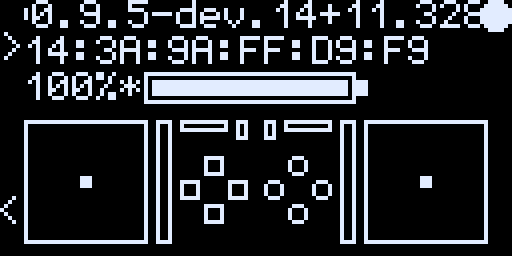

The Status screen live on a real board, captured pixel for pixel over the OLED mirror. Every screen image below is a real capture from the board too.

### Boot splash (1.5 s on power-on)

Centered firmware version on a blank screen for 1.5 seconds, then jumps to the Status screen.

### Eleven screens, cycled with KEY0 on the add-on

Cycle order: **Status → Slots → Lightbar → Trigger Test → Gyro Tilt → Touchpad → Diagnostics → CPU/Clock → BT Signal → VU Meters → Settings →** wrap. **KEY0 short-press steps forward; KEY1 short-press steps backward** — on *every* screen. Per-screen interactions (cycling the trigger preset, cycling the light bar mode, navigating the Settings cursor, switching slots) live on the **DualSense controller buttons**, never on KEY0/KEY1, so the two physical buttons on the OLED add-on always mean the same thing.

Every screen also paints **`>`** at the top-left edge (next to KEY0) and **`<`** at the bottom-left edge (next to KEY1) so the on-screen labels physically pair with the buttons.

#### 1. Status

Connection state, paired DualSense BD address, battery % with bar (`+` charging / `*` complete / `!` error), live analog stick positions (each stick box flashes inverse — a black dot on a white box — while its **L3 / R3** is clicked in), directional buttons, action buttons (△ ◯ ✕ □), L1/R1, and L2/R2 analog trigger fill bars. The link indicator and battery use small pixel icons. While charging, a `~Nm` estimate of the time to 100% appears next to the battery.

With no controller connected it says what to do: **Press PS to connect** (or *No DualSense paired*) and **Hold KEY0 for 2 s to pair a DualSense**. Holding KEY0 for 2 s there opens a 2-minute pairing window for the current slot (the board scans only in such a window: at boot, after a slot switch / forget / wipe, or this), and the screen then shows **Pairing: hold Create + PS** with the time left and a bar. This is the one KEY0 action besides "next screen", and only there: without a controller the board is off USB, so the app can't start pairing.

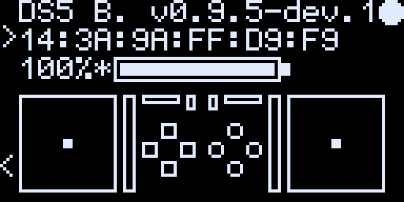

#### 2. Slots

Persistent 4-slot multi-controller pairing. Browse stored controllers, switch active slot, or wipe a single slot. `>` is the cursor, `*` marks the currently active slot.

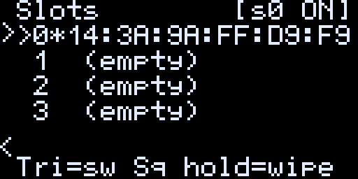

- **Directional buttons ▲▼** — move the cursor across slots 0–3
- **△** — switch to the cursor slot (disconnect current, reconnect to slot's stored controller)
- **□ hold 1.5 s** — wipe the cursor slot (drops bd_addr + BTstack link key)
- Active slot is persisted; the dongle reconnects to it on next boot

#### 3. Lightbar Color Picker

Tilt the controller on each axis to dial in R / G / B; the firmware sends the resulting color to the DualSense's actual light bar at 10 Hz, so the light bar IS the visual preview (the OLED is monochrome).

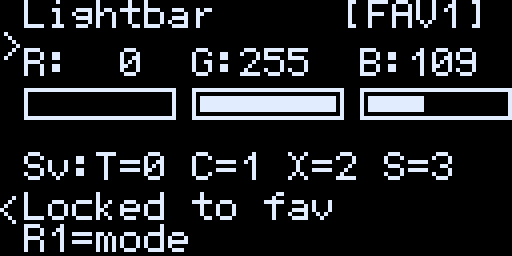

- Press **△ ◯ ✕ □** on the controller to **save** the current color into favorite slot 0 / 1 / 2 / 3
- Press **R1** on the controller to cycle the mode tag: `[LIVE]` → `[FAV0]` → `[FAV1]` → `[FAV2]` → `[FAV3]` → effects (Breathing / Rainbow / Fade) → `[HOST]` → back to `[LIVE]`
- `[HOST]` (the default) hands the light bar to the PC / game; the dongle sets no color. Any other mode keeps the dongle's color, whatever the game sends
- Default favorites: Red, Green, Blue, White

#### 4. Trigger Test

Press **△** on the controller to cycle seven adaptive trigger effects applied to both L2 and R2. Pull each trigger to feel the effect.

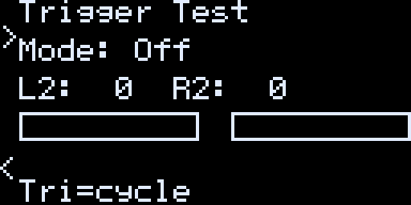

Cycle order: **Off → Feedback → Weapon → Vibration → Bow → Gallop → Machine Gun → Off …** Effect parameters bitpacked per [dualsensectl](https://github.com/nowrep/dualsensectl)'s reverse-engineering, all at max strength.

#### 5. Gyro Tilt

Live X/Y/Z accelerometer values with a 40×40 crosshair box. The dot tracks the controller's tilt in real time and **sits centered when the controller lies flat** — it's driven by the controller's own per-unit factory IMU calibration (parsed from feature report `0x05`), so the rest position and gain are correct on every controller. Tilting left/right and forward/back moves the dot in the matching direction.

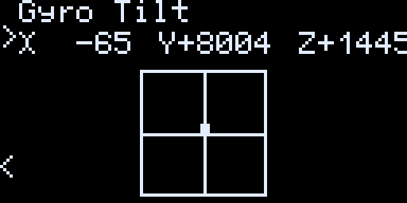

#### 6. Touchpad

Live render of the touch pad surface. Dots appear at current finger positions; the count updates as fingers touch / leave.


#### 7. Diagnostics

Scrollable list of live counters — uptime, BT state, host → BT trigger flow (`host02` / `trig` / `tx`), BT 0x31 input rate, USB audio frames/sec, BT 0x32 packets/sec, and parked mic-investigation counters at the bottom. Controller directional buttons ▲/▼ scroll; tiny `^` / `v` glyphs at the right edge mark "more above/below." Read-only, so no cursor. Useful for verifying the bridge is moving bytes without needing a UART cable.

The same counters are also exported on HID feature report `0xFD` for host-side tooling — see `scripts/mic_diag.sh bt-trace` below.

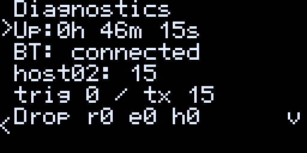

#### 8. CPU / Clock

Live RP2350 vitals: configured (`Set`) and actually-running (`Real`) system clock measured against the crystal reference, core voltage read back from the regulator, and on-die temperature (256-sample average + slow EMA so the value tracks the real die temp rather than ADC noise).

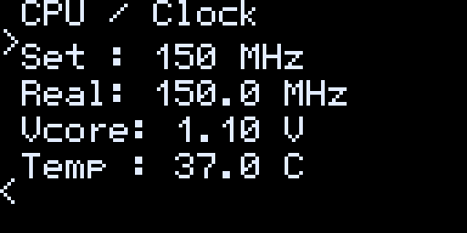

The same telemetry is also exported on HID feature report `0xFC` for tooling.

#### 9. BT Signal

Live Bluetooth signal strength of the active link, in dB relative to the ideal range (0 = ideal, shown as *in range*; more negative is weaker), with a bar from −30 dB (empty) to 0 dB (full) and the app's words for it (Excellent / Good / Fair / Weak). Before the first reading, or when a reading fails, it says `Signal: --` and `Link: unknown`.

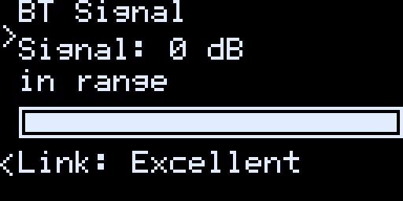

#### 10. VU Meters

Live peak meters for the speaker and haptic audio paths. Useful for verifying audio routing without the controller being plugged in to a host.

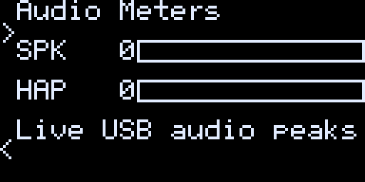

#### 11. Settings

Persistent config editor. It opens on a menu of six groups, each with how many settings it holds: **Haptics/trigger**, **Audio**, **Connection**, **Screen & lights**, **PC sleep** and **Reset**. Directional buttons ▲▼ move the selection; ✕ (or ▶) opens a group, and ○ goes back to the menu where you left it. In a group, ▶◀ adjusts the value. △ saves to flash from anywhere. The row you're on is a lit bar; a value you've changed but not saved yet shows in a dark window in that bar, and the title shows `(*)` until you save.

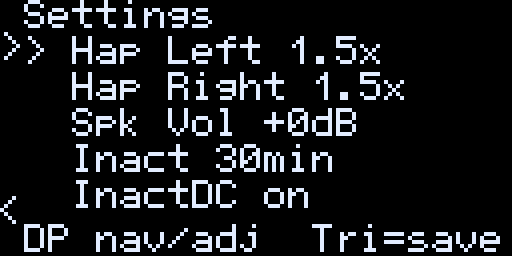

- **Haptics/trigger:** `Vibration L` and `Vibration R` (vibration intensity per side), `Trig. effect` (Trigger Effect Intensity: `game`, the game's own strength, or -1 … -10 weaker), `AutoHap` (the Audio Auto Haptics mode, below), `AutoHap gain` (0–200 % in 10 % steps, default 100 %) and `Auto filter` (the low-pass cutoff before the envelope follower, 80 / 160 / 250 / 400 Hz, default 160 Hz: lower = more sub-bass).
- **Audio:** `Spk volume`, `Spk boost` (Speaker boost, the controller amplifier's pre-gain: `game`, left to the game, or 1 … 7), `Lock volume` (games can't change the controller's speaker, headset or mic volume, mute or mute light; the PC's own volume and mute still apply), `Audio out` (Auto / SPK / Hset / off: where the PC's audio plays; Auto = the headset when one is plugged into the controller), `Built-in mic` (the switch that turns the mic off), `Mic used` (Auto / Int / Hset), `Mic level` (`PC` follows the PC's mic level, or 1–64), `Echo cancel` and `Audio buffer` (32–128).
- **Connection:** `Controller` (DS5 / DSE / Auto), `Poll rate` (250Hz / 500Hz / RT), `Disconnect` (disconnect an idle controller) and `Idle time` (10–60 min).
- **Screen & lights:** `Screen dim` and `Screen off` (minutes; `off` = never), `Wake on input` (controller input wakes the screen) and `Status LED` (the Pico's LED).
- **PC sleep:** `Turn off ctrl` (turn the controller off once the PC has slept for 3 s, default on) and `PS wakes PC` (with no controller connected, the dongle shows up as a wake-only keyboard, "DS5 Dongle Wake Keyboard", so the PS button can wake the PC; default off).
- **Reset:** `Reset to defaults` (hold △ for 2 s; reverts every setting and keeps the current slot) and `Wipe all slots` (hold △ for 2 s; drops all 4 paired controllers and all BTstack link keys).

`AutoHap` modes: `Off` (the default) takes haptics only from the game. `Fallback` fires derived rumble only when the game sends no native haptic data (e.g. Ghost of Tsushima on Linux); note it also vibrates along with music and desktop audio, while games that *do* send native haptics (Spider-Man Remastered) pass through unchanged. `Mix` adds derived on top of native, `Replace` ignores native entirely.

### Button reference

The two physical buttons on the OLED add-on are **strictly navigation**:

| Button | Action |
|---|---|
| **KEY0** short-press | Next screen (forward) |
| **KEY0** held 2 s, Status screen, no controller | Pair now: a 2-minute pairing window for the current slot (anywhere else a KEY0 hold is still "next screen") |
| **KEY1** short-press | Previous screen (backward) |
| **KEY1** held for more than 1.5 s | Change brightness once while held; release does not go back |
| **KEY0 + KEY1** held together ≥ 1 s | `watchdog_reboot` — soft-reboot without unplugging USB |

Per-screen state changes (cycling the trigger preset, cycling the light bar mode, navigating Settings, switching slots, saving colors to favorite slots) all happen on the **DualSense controller buttons** — never on KEY0 / KEY1 — so the two physical buttons always mean the same thing across every screen (the one exception: KEY0 held 2 s on the Status screen with no controller pairs, see Status). A save that fails outside Settings / Slots (the KEY1 brightness, the Lightbar screen's changes, the slot a connecting controller takes) shows a status line over the bottom row of whatever screen is up for 3 s, e.g. `Bright: Save FAIL`. See each screen's section above for which controller button does what.

### Pinout (standard Waveshare Pico HAT layout)

| Function | GPIO |
|---|---|
| MOSI | 11 |
| SCK  | 10 |
| CS   | 9  |
| DC   | 8  |
| RST  | 12 |
| KEY0 | 15 |
| KEY1 | 17 |

### Soft-reboot recovery

Two ways to reboot the dongle without unplugging USB — handy if pairing gets stuck or you want a clean state:

- **OLED KEY0 + KEY1 held simultaneously for ≥ 1 s** → `watchdog_reboot`. Replaces the older "KEY0 double-click" gesture from earlier versions, since rapid forward-navigation kept tripping the double-click timer by accident.
- **DualSense `PS + Mute` held for 2 seconds** → `watchdog_reboot` (works whether or not the OLED is attached — headless backup).

## Acknowledgements

Some features and design ideas in this fork are borrowed from other forks of upstream, with credit:

- **[zurce/DS5Dongle-OLED](https://github.com/zurce/DS5Dongle-OLED)** — pixel-art icons in the OLED status header (visual approach), the "hold for factory reset" UX pattern used by the Settings screen's "Reset to defaults" item (hold △ for 2 s to confirm), and the multi-slot persistent BT pairing system on the new Slots screen (4 bonded controllers, directional buttons to navigate, △ to switch slots, □ hold to wipe a slot, plus "Wipe all slots" in the Settings menu).
- **[loteran/DS5Dongle](https://github.com/loteran/DS5Dongle)** — independent rediscovery of the upstream `3a31bd7` regression that broke speaker / HD haptic output (commit `c7a8d3c`); the fix in our `src/audio.cpp` restores the same SetStateData sub-report. Also the source of the Audio Auto Haptics DSP (1-pole LP + envelope follower, see Settings → Haptics/trigger) and the "don't sync USB-side UAC1 volume to the persistent config" fix.
- **[SundayMoments/DS5_Bridge](https://github.com/SundayMoments/DS5_Bridge)** — a sibling Pico DualSense bridge. The button-remapping apply logic and digital-control set in `src/remap.{h,cpp}` are ported from it. Its audio architecture (on-device Opus encoding vs an optional host-encoding companion app) was also the reference for diagnosing our speaker-cadence ("warble") work. Thanks for the groundwork.
- **[awalol/ds5dongle-config-web](https://github.com/awalol/ds5dongle-config-web)** — the base of our configurator, [MarcelineVPQ/DS5Dongle-OLED-Config-Web](https://github.com/MarcelineVPQ/DS5Dongle-OLED-Config-Web) (a web app at first, the desktop app since 0.8.0). The fork adapted upstream's 13-byte Config_body layout to ours (19 bytes then, 51 now) and added UI for our additions (multi-slot pairing, Auto Haptics).
- **[PS5 Button Icons and Controls](https://zacksly.itch.io/ps5-button-icons-and-controls)** by **Zacksly**: the DualSense controller outline and button glyphs on the configurator's Button assignments page (desktop app and web tool), licensed [CC BY 3.0](https://creativecommons.org/licenses/by/3.0/) (recoloured to `currentColor` and trimmed to fit the themes).

## Roadmap
- Please check out [DS5Dongle plan](https://github.com/users/awalol/projects/5)

## Community
- Join the Discord server: [Discord Server](https://discord.gg/hM4ntchGCa)
- If you have a bug, please open an issue instead.

## References

- [rafaelvaloto/Pico_W-Dualsense](https://github.com/rafaelvaloto/Pico_W-Dualsense) — Project inspiration
- [egormanga/SAxense](https://github.com/egormanga/SAxense) — Bluetooth Haptics POC
- [https://controllers.fandom.com/wiki/Sony_DualSense](https://controllers.fandom.com/wiki/Sony_DualSense) - DualSense data report structure documentation
- [Paliverse/DualSenseX](https://github.com/Paliverse/DualSenseX) — Speaker report packet
